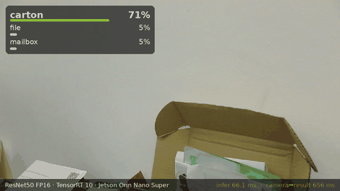

# rt-video-infer

[](https://github.com/blipblop67/rt-video-infer/actions/workflows/ci.yml)
[](LICENSE)

Real-time C++ video inference on NVIDIA Jetson: **GStreamer (NVDEC + VIC) → CUDA preprocess →
TensorRT 10**, with per-stage profiling. Handles one or many streams, batched into one inference
per iteration.

**Highlights** (ResNet50 FP16 on a Jetson Orin Nano Super; details in [Benchmarks](#benchmarks)):
- **8 × 1080p30 H.264 streams in real time with zero dropped frames**, at 12.7 W. The hardware
  video decoder, not the GPU, sets the stream limit.
- **Batched inference at 1.3 ms per frame, with +40% throughput** over one frame at a time when
  the GPU is the bottleneck (551 vs 392 FPS). This comes from a multi-profile TensorRT engine
  with each batch range tuned separately, so a single stream loses nothing.
- **Live USB camera at 30 FPS with 56 ms from camera to result**. MJPEG is decoded on the hardware
  JPEG engine and frames reach CUDA without a copy.
- **Measured, not assumed**: per-stage CUDA-event timing, p50/p99 percentiles, drop counters,
  tegrastats power and GPU logging, and Nsight Systems ranges. Each optimisation in the
  README is backed by before/after numbers.
- **Verified**: predictions were checked frame by frame against single-stream reference runs,
  including a test that batched frames never land in another stream's slot. Pure logic is unit
  tested in CI.



*Live from a USB camera (Logitech Brio 100, 1280×720 MJPEG decoded on the hardware JPEG engine):
top-3 ImageNet classes, TensorRT inference time, and camera-to-result latency for each frame.
Full-quality clip: [assets/demo_usb_camera.mp4](assets/demo_usb_camera.mp4). Recorded with
`scripts/record_demo.sh`.*

```
source ─► nvv4l2decoder (NVDEC) ─► nvvidconv (VIC: NV12→RGBA, scale to 224×224) ─► appsink(drop, max-buffers=1)
                                                                                     │
          ┌──────────────────────────────────────────────────────────────────────────┘
          ▼  --mem nvmm: NvBufSurface → EGLImage → CUDA pointer (zero copy, registered once per pool surface)
             --mem cpu : system memory → cudaMemcpy2DAsync
   CUDA kernel: RGBA8 → normalized NCHW (fp32 or fp16, matches the engine)
          ▼
   TensorRT enqueueV3 ─► D2H ─► argmax
```

With several sources, each stream has its own pipeline and appsink. Every iteration, the gatherer
takes the newest frame from each stream: by default it waits until every live stream has one, or
with `--batch-timeout MS` it waits at most MS after the first frame arrives. Each frame is
preprocessed into its own row of the input tensor, and one `enqueueV3` runs the whole batch. A
dynamic-batch engine runs exactly the frames it was given, so the batch shrinks when a stream ends
or misses the deadline. A fixed-batch engine smaller than the stream count runs several times per
iteration; this is the "sequential" baseline below.

`appsink drop=true max-buffers=1` means the app always runs inference on the newest frame and
never builds up a backlog. The profiler reports how many stale frames were replaced.

nvvidconv recycles a small, fixed pool of NVMM buffers. In NVMM mode, each surface is therefore
EGL-mapped and registered with CUDA the first time it appears, then reused. The cache is keyed on
the surface pointer and its dmabuf fd, so a reallocated pool is detected. `--no-egl-cache` brings
back per-frame registration for comparison.

## Tested on

Jetson Orin Nano Super Dev Kit · L4T R36.5 (JetPack 6) · MAXN_SUPER · CUDA 12.6 · TensorRT 10.3 ·
GStreamer 1.20.

## Build & run

```bash
cmake -S . -B build && cmake --build build -j$(nproc)
scripts/build_engine.sh                                        # ResNet50 fp16 → models/ResNet50_fp16.engine
scripts/build_engine.sh /usr/src/tensorrt/data/resnet50/ResNet50.onnx fp16io   # fp16 I/O variant
scripts/build_batch_engine.py --profiles 1,4,8                 # profiles [1],[2..4],[5..8] → models/ResNet50_fp16_p1-4-8.engine
scripts/build_batch_engine.py --max-batch 8                    # single profile 1..8 tuned at 8 → models/ResNet50_fp16_b8.engine
scripts/make_test_video.sh media/test_1080p.mp4 20             # 1080p H.264 clip (x264enc; Orin Nano has no NVENC)
PATTERN=ball scripts/make_test_video.sh media/ball_360p.mp4 20 640x360

L=/usr/src/tensorrt/data/resnet50
./build/rtinfer --engine models/ResNet50_fp16.engine --source image:$L/tabby_tiger_cat.jpg --labels $L/class_labels.txt
./build/rtinfer --engine models/ResNet50_fp16.engine --source file:media/test_1080p.mp4 --no-sync

# multi-stream: repeat --source, or replicate one with --streams N
./build/rtinfer --engine models/ResNet50_fp16_p1-4-8.engine --source csi:0 --source rtsp://cam2/stream --batch-timeout 10
./build/rtinfer --engine models/ResNet50_fp16_p1-4-8.engine --source file:media/test_1080p.mp4 --streams 8
```

`build_batch_engine.py` is needed because the ResNet50 sample ONNX has batch size 1 hard-coded in
its Reshape nodes. The script makes the input batch dynamic and rewrites those reshapes to `-1`.

TensorRT tunes each optimization profile at one batch size (its "opt"). A single 1..8 profile
tuned at 8 runs batch 1 almost twice as slowly as a batch-1 engine. With `--profiles 1,4,8`,
each range is tuned at its upper bound. rtinfer creates one execution context per profile, all
sharing a single activation buffer because they run one after another on the same stream, and it
runs each batch on the profile with the smallest upper bound that fits.

Sources: `test` (videotestsrc 720p30), `file:clip.mp4` (H.264), `image:pic.jpg`, `csi:0`
(nvarguscamerasrc), `usb:/dev/video0` (raw YUY2 at 30 FPS), `mjpeg:/dev/video0[@1280x720]` (USB
camera MJPEG, decoded on the hardware JPEG engine), `rtsp://…`, or
`pipeline:'<elements ending in nvvidconv>'`.

With USB cameras, prefer `mjpeg:`. UVC cameras usually offer 30 FPS raw only at low resolutions.
Unconstrained raw caps made the Brio 100 pick 1080p at 5 FPS, with 222 ms latency. With `usb:`
(640×480 raw) or `mjpeg:` (720p or 1080p), it runs at 30 FPS with about 56 ms from camera to
result, of which inference is 2.3 ms.
Run `./build/rtinfer` with no arguments to see every option.

The engine's input size decides the VIC output size. The engine's I/O tensor types (fp32 or
fp16) decide what the preprocess kernel writes. Any single-input, single-output NCHW
classifier works; set `--mean/--std` to match how it was trained.

## Tests

```bash
ctest --test-dir build --output-on-failure                     # after the normal build
cmake -S . -B build-ci -DRTINFER_BUILD_APP=OFF && cmake --build build-ci && ./build-ci/unit_tests   # no Jetson needed
```

The pipeline logic that needs no GPU is kept in a small dependency-free core: source-spec
parsing, percentile statistics, top-K selection, and the choice of TensorRT optimization profile
(including padding a batch up to a profile's minimum). It has 27 unit tests, which CI runs on
every push. GPU, codec and camera behaviour can't run on GitHub's runners, so it is checked on
the device instead: frame-by-frame prediction matching against reference runs, as described
under Benchmarks.

## Profiling

| Layer | Tool | What you get |
|---|---|---|
| Per-batch stages | built-in (CUDA events + steady_clock) | mean/p50/p90/p99/max for gather, map, H2D, preprocess, infer, D2H, post, process and capture→result latency (worst frame in the batch); per-frame inference time; dropped frames; aggregate FPS; per-stream processed/arrived counts |
| Raw data | `--csv`, `--json`, `--pred-csv` | one CSV row per batch, a JSON summary for comparing runs, and per-frame predictions (stream, PTS, class, score) |
| System | `scripts/run_profiled.sh` | runs the app alongside `tegrastats`, then prints average GPU%, CPU%, RAM and VDD_IN power |
| Streams | `scripts/bench_streams.sh rt\|max [clip] [counts…]` | runs N = 1/2/4/8 streams, batched vs sequential, and prints FPS, drops, mean batch, per-frame inference, latency, GPU% and power |
| Matrix | `scripts/bench_all.sh [engine] [clip]` | runs every combination of memory mode (cpu / nvmm / nvmm-nocache) and pacing (real-time / max) and prints one comparison table |
| Timeline | `NSYS=1 scripts/run_profiled.sh …` | Nsight Systems trace with NVTX ranges (`gather`, `batch`, `map`, `gpu sync`, `postprocess`) and TensorRT per-layer ranges |
| Engine only | `scripts/build_engine.sh` | trtexec throughput plus a per-layer profile in `reports/*.layers.json` |

```bash
scripts/run_profiled.sh nvmm_rt  --engine models/ResNet50_fp16.engine --source file:media/test_1080p.mp4 --frames 0
NSYS=1 scripts/run_profiled.sh trace --engine models/ResNet50_fp16.engine --source file:media/test_1080p.mp4 --frames 200 --no-sync
nsys stats --report nvtx_sum reports/trace.nsys-rep
```

## Recording a demo

```bash
scripts/record_demo.sh /dev/video0 10 demo_usb_camera      # 10 s from the camera → assets/demo_usb_camera.{gif,mp4}
```

The script runs rtinfer on a `pipeline:` source in which a `tee` records exactly the frames being
classified: MJPEG is decoded on the hardware JPEG engine, scaled by VIC, and encoded with x264.
`--pred-csv` stores the top 3 classes with each frame's PTS, and `scripts/render_demo.py`
matches them to the recorded frames by timestamp. It overlays the predictions and timings and
writes an MP4 plus a GIF at 480 px and 10 FPS. GitHub plays GIFs inline in a README but not
MP4s stored in the repo, so the README embeds the GIF and links the MP4. When rtinfer stops, it
sends end-of-stream (EOS) before shutting the pipeline down, so the recording branch's MP4 is
finalized properly.

`e2e latency` is (pipeline clock now) − (buffer running time), measured once the result is ready.
For live sources (camera, RTSP, `test`, `image:`) this is capture-to-result latency. For files
with sync, appsink holds each buffer until its PTS, so the number shows only the processing after
release. It is not recorded with `--no-sync`.

## Benchmarks

### Single stream (ResNet50 fp16, 224×224, 1080p30 H.264 file, Orin Nano Super, MAXN_SUPER)

From `scripts/bench_all.sh models/ResNet50_fp16.engine`. Times are means in ms, except the p99 column.

| Mode | Pacing | FPS | drops | map | preprocess | infer | process | process p99 | GPU % | VDD_IN |
|---|---|---|---|---|---|---|---|---|---|---|
| cpu | real-time | 30.0 | 0 | 0.028 | 0.283 | 1.908 | 2.323 | 2.402 | 17 | 9.0 W |
| **nvmm (cached)** | real-time | 30.0 | 0 | **0.002** | 0.325 | 1.906 | **2.316** | **2.367** | 7 | **8.4 W** |
| nvmm-nocache | real-time | 30.0 | 0 | 0.156 | 0.330 | 1.944 | 2.600 | 2.742 | 6 | 8.4 W |
| cpu | `--no-sync` | 240.7 | 0 | 0.007 | 0.046 | 1.941 | 2.059 | 2.479 | 36 | 12.6 W |
| **nvmm (cached)** | `--no-sync` | 240.6 | 0 | **0.001** | 0.099 | 1.917 | 2.083 | **2.287** | 37 | 12.6 W |
| nvmm-nocache | `--no-sync` | 240.7 | 0 | 0.112 | 0.152 | 1.979 | 2.384 | 2.647 | 40 | 12.6 W |

Correctness: on a 300-frame moving-ball clip (7 distinct top classes, with scores changing by up
to 0.18 between frames), all three modes give **bit-identical** class and score on every frame.
The cat image predicts class 282 "tiger cat" (0.624) in every mode.

Findings:
- **Caching the EGL/CUDA registration removes the zero-copy overhead.** Map time drops from
  0.11–0.16 ms to about 0.002 ms, and process time falls by 0.3 ms (about 11%). Cached NVMM now
  matches or beats the copy path, has the tightest p99 and draws the least power in real time.
  Without the cache, zero copy is the slowest mode.
- **At max throughput the source is the bottleneck, not TensorRT.** The process stage alone would
  allow about 480 FPS. The loop still waits about 2 ms per frame for decode and VIC, which caps it
  at 240 FPS.
- **The FP16 I/O engine (`fp16io`)** removes TensorRT's FP32→FP16 input reformat node (visible
  in nsys). End to end, inference time is unchanged within noise (about 1.9 ms either way).
- **The desktop is a source of noise.** gnome-shell keeps the GPU 6–40% busy at idle, and this
  load varies. That variation shows up mainly in the small preprocess kernel and in p99 times. Run
  the Jetson headless (multi-user.target) for repeatable numbers.

### Multi-stream (ResNet50 fp16, Orin Nano Super)

Three engines are compared:
- "multi-profile" uses `ResNet50_fp16_p1-4-8.engine`, with one enqueue per iteration on the
  best-fitting profile.
- "single-profile" uses `ResNet50_fp16_b8.engine`, with one 1..8 profile tuned at batch 8.
- "sequential" uses the fixed batch-1 `ResNet50_fp16.engine`, with one enqueue per frame.

Times are in ms per batch unless noted. The two tables come from separate sessions, so compare
rows within a table. Desktop GPU load moves the sequential baseline by up to 25% between sessions.

**Real time, N × 1080p30 H.264** (`BATCHED=models/ResNet50_fp16_p1-4-8.engine scripts/bench_streams.sh rt media/test_1080p.mp4`):

| Streams | Engine | FPS | drops | infer / frame | process | process p99 | latency p50 | latency p99 | GPU % | VDD_IN |
|---|---|---|---|---|---|---|---|---|---|---|
| 1 | multi-profile | 30.0 | 0 | 1.92 | 2.31 | 2.62 | 2.4 | 2.8 | 31 | 9.2 W |
| 1 | sequential | 30.0 | 0 | 1.90 | 2.28 | 2.74 | 2.4 | 2.8 | 33 | 9.0 W |
| 2 | **multi-profile** | 60.0 | 0 | **1.69** | **3.80** | **7.21** | **4.5** | 8.1 | 28 | **9.6 W** |
| 2 | sequential | 60.0 | 0 | 1.93 | 5.53 | 8.09 | 5.8 | 8.6 | 42 | 10.3 W |
| 4 | **multi-profile** | 120.0 | 0 | **1.31** | **5.75** | **8.46** | **13.9** | **16.7** | 20 | **10.5 W** |
| 4 | sequential | 120.0 | 0 | 1.91 | 8.31 | 10.34 | 16.7 | 18.8 | 25 | 10.9 W |
| 8 | **multi-profile** | 240.0 | 0 | **1.30** | **10.95** | **15.45** | 39.2 | 66.0 | 31 | **12.7 W** |
| 8 | sequential | 240.1 | 0 | 1.91 | 16.24 | 21.83 | 40.2 | 59.9 | 50 | 14.0 W |

**Max throughput, N × 640×360** (`scripts/bench_streams.sh max media/ball_360p.mp4`). Decode is
fast at this size, so the GPU is the bottleneck. Drops of 55–80% are expected: appsink keeps only
the newest frame. The single-profile column comes from an earlier session.

| Streams | multi-profile FPS | sequential FPS | single-profile FPS | multi-profile infer / frame | single-profile infer / frame |
|---|---|---|---|---|---|
| 1 | 331 | 349 | 241 | **1.94** | 3.77 |
| 2 | **403** | 352 | 365 | 2.10 | 2.34 |
| 4 | **468** | 338 | 473 | 1.70 | 1.85 |
| 8 | **551** | 392 | 492 | 1.72 | 1.94 |

Correctness:
- **Slot mapping.** Four *different* sources (tabby cat, binoculars, the moving-ball clip, reflex
  camera) were run as one batch of 4 on the single-profile engine. Each stream's predictions were
  matched by PTS against a single-stream run of the same source: 1000/1000 frames had the same
  class and a score difference of 0.00000. When the clip ended, the batch shrank to 3 and the
  other streams continued.
- **Each profile.** Those sources were then run through every profile of the multi-profile engine
  (1 stream → [1], 4 → [2..4], 8 → [5..8], with each source twice) and compared with the fixed
  batch-1 engine. 4119 of 4120 frames had the same class, with score differences up to 0.016, as
  expected between separately tuned FP16 engines. The one disagreement is a near-tie on a single
  ball-clip frame (class 111 at 0.0443 vs class 818 at 0.0459). It shows up in both duplicate
  streams of that source, and the two duplicates agree with each other.

Findings:
- **An Orin Nano runs 8 × 1080p30 in real time with no drops.** That is 240 FPS, which matches
  the single-stream decode ceiling, so NVDEC sets the stream limit, not the GPU.
- **Multi-profile engines remove the batch-1 penalty.** A single 1..8 profile tuned at 8 ran
  batch 1 at 3.8 ms; the [1] profile runs it at 1.9 ms, the same as a fixed batch-1 engine. A
  single engine file can now serve any stream count.
- **Batching wins from 2 streams up.** Processing time is 31–33% lower at 2, 4 and 8 streams.
  At 8 streams, GPU load drops from 50% to 31% and power drops by 1.3 W for the same 240 FPS.
- **Batching gives +40% throughput when the GPU is the limit**: 551 vs 392 FPS at 8 streams.
  That is also 12% more than the single-profile engine, because batch 8 now runs on tactics tuned
  for batch 8 while batches 2–4 get their own profile.
- **At 8 streams, latency comes from gathering, not inference.** The 8 decoders time-slice NVDEC,
  so frames arrive staggered, and waiting for all of them puts p50 latency at about 40 ms whatever
  the engine. Use `--batch-timeout` to cap that wait and run smaller batches when the deadline
  passes.
- **With unsynchronised live sources, latency depends on phase.** Three still-image streams gave
  56 ms (batched) in one run and 36 ms (sequential) in another, even though batched processing
  was twice as fast. Waiting for every stream adds up to one frame period, depending on how far
  apart the streams' frame phases happen to be. Compare latency on synchronised sources, or set
  `--batch-timeout`.

## Next steps

- Overlap preprocessing of batch k+1 with inference of batch k (double-buffered input tensors,
  two CUDA streams). This would mainly help in the GPU-bound 360p case.
- Fill a batch with one preprocessing launch: pass an array of frame pointers to the kernel instead
  of launching once per frame.
- INT8 with a calibration cache (`trtexec --int8 --calib=…`).

## Layout

```
src/gst_source.*   GStreamer pipeline, appsink, NVMM→CUDA EGL interop, latency, drop counter
src/preprocess.cu  RGBA→NCHW normalize kernel (fp32/fp16)
src/trt_engine.*   TensorRT 10 engine loader (named tensors, fixed batch or multi-profile dynamic batch)
src/profiler.*     per-stage stats, CSV/JSON, NVTX helpers
src/main.cpp       CLI, multi-stream batch gatherer, per-batch loop
src/source_spec.*  source spec → GStreamer pipeline string        ┐ dependency-free core
src/stats.h        mean / nearest-rank percentiles                │ ("rtcore"), unit tested
src/topk.h         single-pass top-K selection                    │ in CI on any machine
src/batch_plan.h   optimization-profile choice and row padding    ┘
tests/             unit tests (tiny built-in harness, run with ctest)
.github/workflows/ CI: core + tests with g++ and clang++, script syntax checks
assets/            README demo (GIF inline, MP4 full quality)
scripts/           engine builds (trtexec + dynamic-batch Python builder), test clips, demo recorder/renderer,
                   tegrastats/nsys wrapper, benchmark matrices
```
